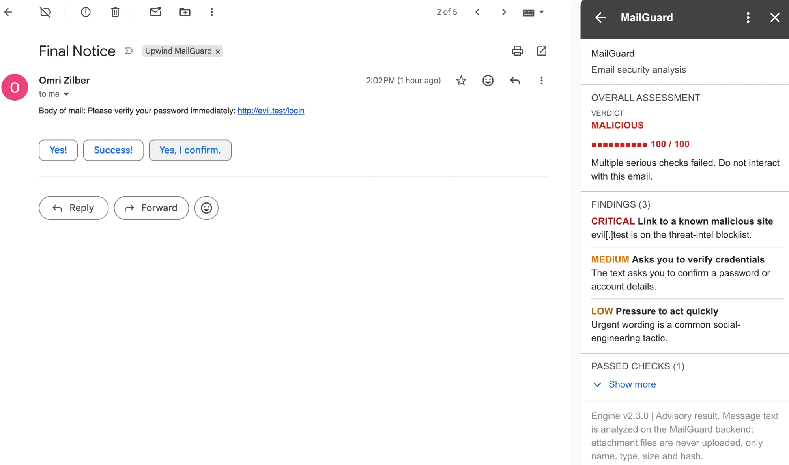

# MailGuard

A Gmail add-on that checks the email you have open and shows a **score (0-100)**, a **verdict**
(Safe, Suspicious, Malicious, Inconclusive) and the **reasons** behind it.


*The card for a phishing-style email: a link to a blocklisted site, a password request and urgent wording.*

## How it works

```
Gmail add-on  ──(HTTPS + Google sign-in token)──►  FastAPI backend
(extract + show)  ◄────── score, verdict, reasons ──  (all the detection)
```

1. The **add-on** reads the open email and sends it to the backend. It contains no detection logic.
2. The **backend** checks the token, runs the analyzers and applies the scoring rules.
3. The add-on shows the result, colored by risk: 71-100 red, 31-70 amber, 0-30 green.

Each analyzer looks for one kind of problem and returns **signals**: a named finding with a severity
(`low`, `medium`, `high`, `critical`) and a plain explanation.

| Analyzer | What it looks for |
|---|---|
| Authentication | SPF, DKIM, DMARC failures (read from the header Gmail adds) |
| Sender | Spoofing: Reply-To or Return-Path on another domain, fake display name |
| Links | Tricks like `user@host` URLs, IP-address links, link text that lies |
| Attachments | Dangerous types, `invoice.pdf.exe`, a file whose contents don't match its name |
| Content | Password or payment requests, forms, urgency, hidden text |
| Reputation | Links or files on a local blocklist of known-bad sites and hashes |
| LLM review (optional) | A plain-language summary and an advisory "looks like phishing" flag |

## Scoring: simple yes/no rules, no math
The first rule that is true decides both the verdict and the score, so they always agree.

| If… | Verdict | Score |
|---|---|---|
| any critical signal | Malicious | 100 |
| two or more high | Malicious | 90 |
| one high | Suspicious | 60 |
| any medium | Suspicious | 40 |
| a core check could not run | Inconclusive | none |
| only low | Safe | 10 |
| nothing found | Safe | 0 |

If a core check fails and nothing worse was found, the answer is **Inconclusive**, never a false Safe.

## Security
- **Only the add-on can call the API:** every request needs a valid Google token; without configuration the API refuses all requests.
- **Attachments stay in Gmail:** only name, type, size, hash and the first 16 bytes are sent.
- **Input is untrusted:** size limits on every field, and no link from an email is ever opened.
- **Safe display:** all text shown in the card is escaped.
- **LLM is advisory:** the email is treated as data, personal details are masked, and the LLM can add one medium signal at most. It can never lower a verdict.
- **Secrets** come from environment variables, never from the repo.

With `ANTHROPIC_API_KEY` set, the subject and the first 4 KB of the body (emails and phone numbers masked) go to
the Anthropic API. Unset the key, or set `LLM_ENABLED=false`, to turn this off.

## Run it
Prerequisites: Python 3.10+, [ngrok](https://ngrok.com) (a free static domain), a Gmail account.
All commands run from the `backend/` folder unless noted.

1. **Install and test the backend**
   ```bash
   cd backend
   python3 -m venv .venv && .venv/bin/pip install -r requirements.txt
   .venv/bin/python -m pytest -q          # 68 tests
   ```
2. **Open a public HTTPS tunnel** (Gmail can only call public URLs), in a second terminal:
   ```bash
   ngrok http --url=<your-domain> 8080
   ```
3. **Install the add-on.** Create a project at script.google.com and paste the files from `addon/`.
   Set the Script property `BACKEND_URL` and the `urlFetchWhitelist` in `appsscript.json` to your tunnel URL.
   Then Deploy → Test deployments → install.
4. **Get the audience** (the OAuth client ID the tokens are issued for): run this once in the Apps Script editor
   and copy the logged value.
   ```javascript
   function showAud() {
     const p = ScriptApp.getIdentityToken().split(".")[1];
     Logger.log(JSON.parse(Utilities.newBlob(Utilities.base64DecodeWebSafe(p)).getDataAsString()).aud);
   }
   ```
5. **Start the backend**
   ```bash
   GOOGLE_AUDIENCE=<audience-from-step-4> .venv/bin/uvicorn app.main:app --port 8080
   ```
6. Open any email in Gmail. The MailGuard card appears in the side panel.

Optional: `ANTHROPIC_API_KEY=<key>` (set in step 5) enables the LLM summary.
`python3 scripts/update_feeds.py` refreshes the blocklist from the OpenPhish public feed.

## Demo emails
| Email | Result |
|---|---|
| A real receipt from a known sender | Safe |
| "Please verify your account within 24 hours" with a PNG renamed `invoice.pdf` | Suspicious, 60 |
| "Please verify your password: http://evil.test/login" (`evil.test` is a seeded blocklist entry) | Malicious, 100 |

## Why it is built this way
- **Rules, not machine learning:** every result can be explained, and there is no labeled data.
- **Thin add-on:** logic in the backend is easy to test and change without redeploying the add-on.
- **Gmail's own authentication result:** no re-checking SPF and DKIM ourselves.
- **Local blocklist:** fast, offline, no rate limits.

## Limitations
- The blocklist is a snapshot, not live. There are no live lookups such as VirusTotal.
- Content checks are keyword-based and can be noisy.
- The LLM path is tested with a mocked API only.
- It runs from a laptop through a tunnel. A real deployment needs a container, rate limiting and logging.

## Layout
`addon/` Apps Script add-on · `backend/app/` API, analyzers, scoring · `backend/tests/` tests ·
`design.md` the target design (some parts are not built; this README describes what is built)
